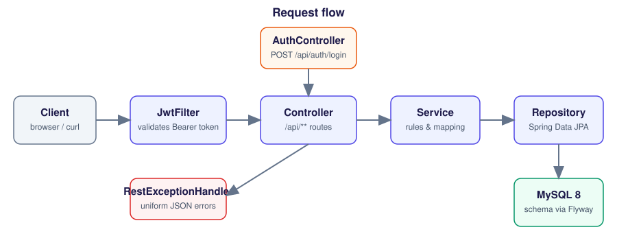
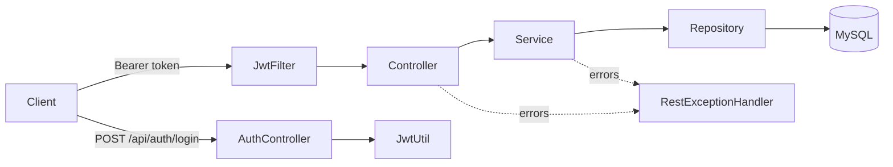
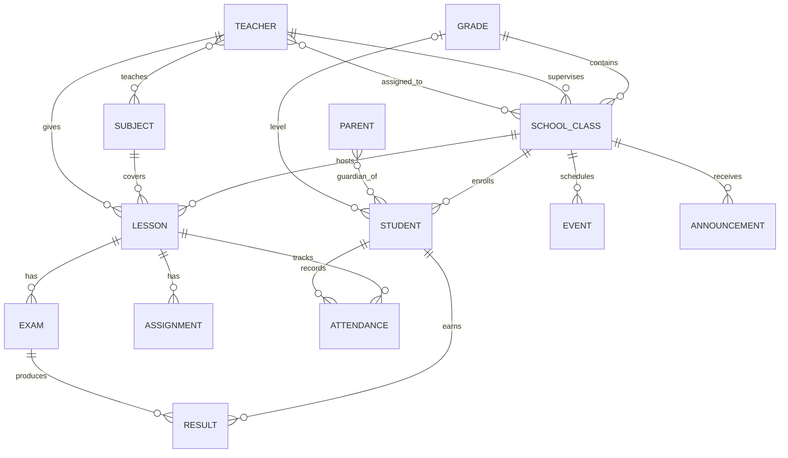
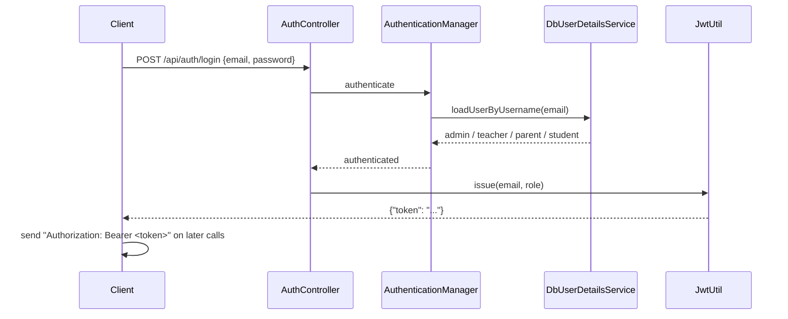

# Campus

A REST backend for running a school: people (admins, teachers, parents, students), classes, lessons, exams, results, attendance, events and announcements. Built with Spring Boot 3, Spring Data JPA, Spring Security (JWT) and Flyway on MySQL



## Features

- CRUD endpoints for 14 resources under `/api/**`
- Stateless JWT login for four roles: `ADMIN`, `TEACHER`, `PARENT`, `STUDENT`
- BCrypt password hashing; passwords are write-only in JSON
- Class capacity enforcement (a full class returns `409 Conflict`)
- Versioned schema migrations (Flyway, `V1` to `V26`)
- Uniform JSON error responses
- Optional scripts to boot a dev database and load fake demo data

## Architecture

Each domain package follows the same layering:



## Data model



## Authentication flow



## Quick start

Requirements: Java 17+, Maven 3.9+, Docker

```bash
cp .env.example .env          # then edit the values
export $(grep -v '^#' .env | xargs)

docker compose up -d db       # MySQL on localhost:3307

mvn spring-boot:run           # app on http://localhost:8082
```

Create a first admin (any BCrypt hash works; `mvn exec:java` with `PasswordHash` or any tool):

```sql
INSERT INTO admin (full_name, email, password, role)
VALUES ('Initial Admin', 'admin@example.com', '<bcrypt-hash>', 'ADMIN');
```

Or let the helper do everything (needs `pip install bcrypt`):

```bash
python scripts/bootstrap_dev.py
```

Optional demo data:

```bash
pip install requests faker tqdm
python scripts/seed_demo_data.py --admin-email "$ADMIN_EMAIL" --admin-pass "$ADMIN_PASSWORD"
```

## Configuration

| Variable | Purpose | Default |
|---|---|---|
| `DB_URL` | JDBC URL | local MySQL on port 3307, database `campusdb` |
| `DB_USER` | database user | `root` |
| `DB_PASSWORD` | database password | empty |
| `JWT_SECRET` | token signing key, **required**, 32+ characters | none |
| `JWT_TTL_MINUTES` | token lifetime | `480` |
| `SERVER_PORT` | HTTP port | `8082` |

## API overview

All routes except `/api/auth/**` need `Authorization: Bearer <token>`

| Resource | Base path | Operations |
|---|---|---|
| Auth | `/api/auth` | `POST /login` |
| Admins | `/api/admins` | list, get, create, update, delete |
| Teachers | `/api/teachers` | list, get, create, update, delete |
| Parents | `/api/parents` | list, get, create, update, delete |
| Students | `/api/students` | list, get, create, update, delete |
| Grades | `/api/grades` | list, get, create, update, delete |
| Classes | `/api/classes` | list, get, create, update, delete |
| Subjects | `/api/subjects` | list, get, create, update, delete |
| Lessons | `/api/lessons` | list, get, create, update, delete |
| Exams | `/api/exams` | list, get, create, update, delete |
| Assignments | `/api/assignments` | list, get, create, update, delete |
| Results | `/api/results` | list, get, create, update, delete |
| Attendances | `/api/attendances` | list, get, create, update, delete |
| Events | `/api/events` | list, get, create, update, delete |
| Announcements | `/api/announcements` | list, get, create, update, delete |

Example:

```bash
TOKEN=$(curl -s localhost:8082/api/auth/login \
  -H 'Content-Type: application/json' \
  -d '{"email":"admin@example.com","password":"<your password>"}' | jq -r .token)

curl -s localhost:8082/api/students -H "Authorization: Bearer $TOKEN"
```

Errors share one shape:

```json
{ "timestamp": "2026-01-01T10:00:00Z", "status": 404, "error": "Not Found", "message": "Student 7 not found" }
```

## Project layout

```
campus-api/
├── docker-compose.yml
├── pom.xml
├── scripts/
│   ├── bootstrap_dev.py        # DB container + app + first admin
│   └── seed_demo_data.py       # fake data through the API
├── docs/
│   ├── images/architecture.svg
│   └── screenshots/
└── src/main/
    ├── java/com/example/campus/
    │   ├── <domain>/{controller,service,repository,model,dto}
    │   ├── auth/  security/  config/  common/  util/
    │   └── CampusApplication.java
    └── resources/
        ├── application.properties
        └── db/migration/        # Flyway V1 ... V26
```
